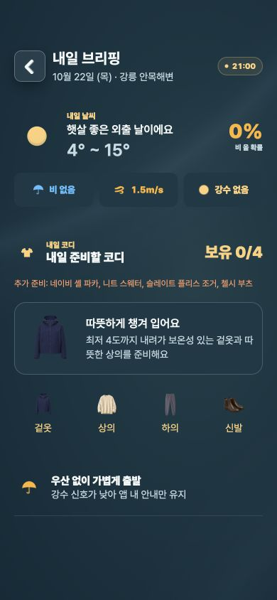
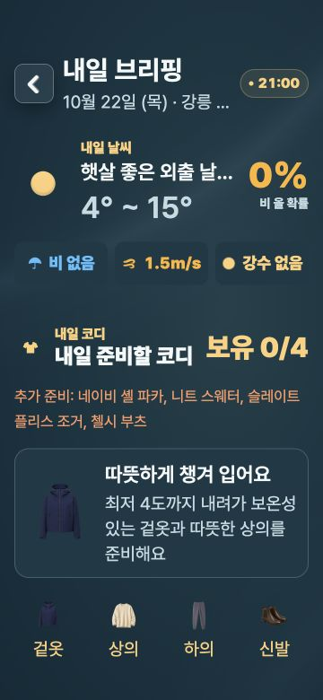

# 추운 날 코디 추천 수정 · 2026-10-21

첨부 TestFlight 피드백과 IMG_7118의 최저 3.63–3.85°C / 최고 14–15°C 조건을 재현함. 수정 전 실제 `buildTomorrowWeather → recommendOutfit` 호출 결과는 얇은 가디건과 스트라이프 긴팔, `최저 3.85도까지 내려가 얇게 걸칠 옷…`이었고 회귀 검사가 실패했음.

## 변경

- 하루 중간값만으로 추위를 판정하지 않고 해당 지역·날짜의 최저/최고와 시간별 예보를 함께 반영함. 오늘 코디의 남은 시간 범위는 기존대로 유지함.
- 제품 기준: 체감/대체 기온 8°C 이하, 예보 최고 12°C 이하, 또는 최저 8°C 이하이면서 최고 18°C 이하이면 보온 코디를 선택함. 입력값은 반올림하지 않음.
- 추운 날 상의·겉옷은 겨울 계절과 보온 태그를 모두 충족한 후보 안에서 선택함. 얇은 보유 옷이나 보온 태그가 없는 방수 옷이 적절한 보온 후보보다 우선되지 않음.
- 내일 예보에 오늘의 체감온도·습도·자외선·미세먼지를 복사하지 않음. 시간별 자료가 부족해도 실제 일 최저/최고는 유지하며 가상 시간별 자료를 만들지 않음.
- 추천 이유의 기온과 일교차는 정수로 표시함. 최저 3.85°C는 `최저 4도`로 표시됨.
- 내일 브리핑·목적지 코디의 추천 이유는 줄바꿈함. 새 문구의 영어·일본어 번역 추가함.
- 추천 규칙 버전을 0.5.0으로 변경함.

## 검증

- `node scripts/check-outfit-cold-forecast.mjs`: 실패 재현 후 통과. 첨부 조건, 일 예보만 있는 경우, 일부 시간만 있는 경우, 소수 경계값, 더위, 실제 체감 추위, 비와 추위, 보유 옷 우선순위, 누락된 0/NaN, 지역 날짜를 검사함. 기존 `check:weather-outfit-regressions` 실행에 포함됨.
- `node scripts/check-weather-outfit-regressions.mjs`: 통과.
- `node scripts/check-shared-rules.mjs`: 통과.
- `node scripts/check-today-outfit.mjs`: 통과.
- `node --no-warnings scripts/check-correctness-batch.mjs`: 통과.
- `node scripts/generate-mobile-locales.mjs --check`: 2,237개 문구 검사 통과.
- `node --no-warnings scripts/check-ios-widget-sync.mjs`: 동작·네이티브 소스 계약 검사 통과(Swift 실행 아님).
- `node scripts/check-android-widget.mjs`: 연결·소스 검사 통과(Android 실기기 검증 아님).
- `tsc --noEmit -p apps/mobile/tsconfig.json`: 통과.
- 실제 TomorrowBriefScreen을 RN Web 어댑터로 렌더링해 In-app Browser에서 검사함. 390×844 및 360×780 / 글자 1.4배에서 보온 코디와 정수 표시를 확인함. 확대 화면 추천 이유 영역의 client/scroll 크기가 같아 잘림이 없었음.

## 범위와 한계

현재 체크아웃 `fix/mac-existing-uiux-search-20261020`에 적용한 코드 수정임. `/private/tmp/weatheron-ios-release`의 2ce655e 및 설치된 TestFlight 바이너리를 변경하지 않았음. 이번 변경의 네이티브 빌드, Xcode Cloud, TestFlight 배포와 실기기 재검증은 수행하지 않았음. 브라우저는 고정 예보·시각과 iOS 어댑터를 사용한 화면 검사임.

보온 판단은 기존 계절·날씨 태그를 사용하며 실제 옷의 두께나 개인 추위 민감도를 측정하지 않음. 새 추천 옵션이나 의존성은 추가하지 않았고, 기존 미완료 변경을 보존했음.
