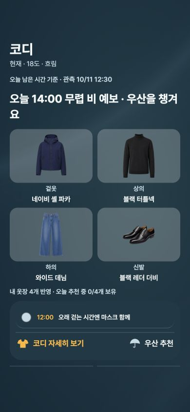
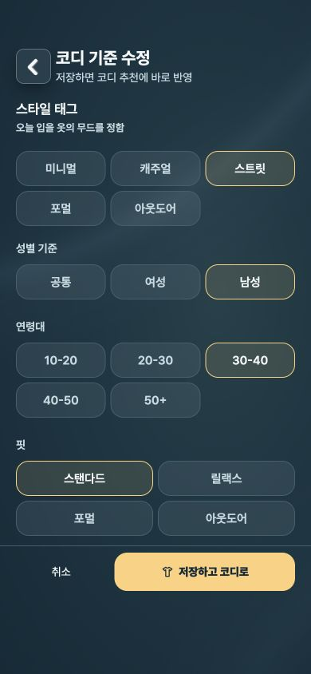
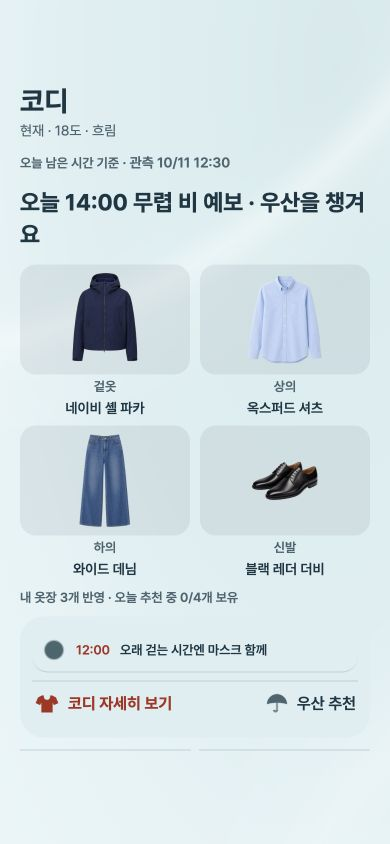
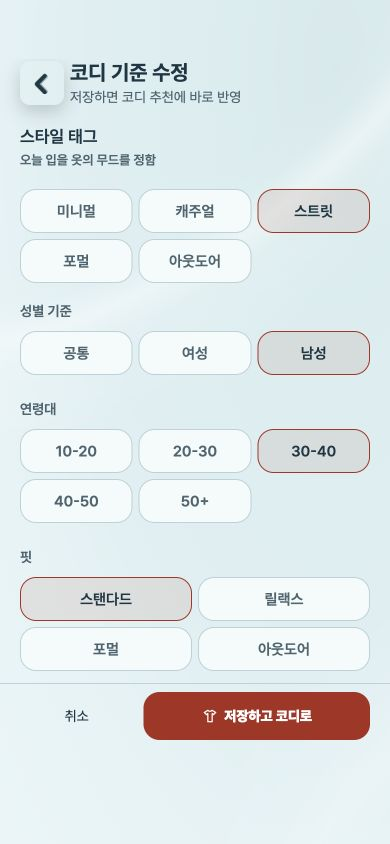
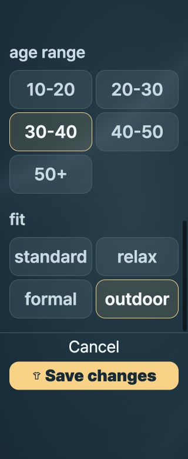

# 코디 이미지와 설정 UI · 2026-10-21

IMG_7119와 IMG_7120 피드백을 반영함. 기존 Ambient Surface 토큰과 컴포넌트를 사용했으며 데이터·추천 로직·저장 경로는 변경하지 않았음.

| Severity | Location | Before | After | Why |
| --- | --- | --- | --- | --- |
| MEDIUM | OutfitGrid, OutfitDetailScreen, WardrobeScreen | 투명 이미지 영역에서 검정·네이비 의상이 어두운 화면과 겹침 | 공통 `outfitImageSurface` 색상 역할로 라이트·다크별 은은한 배경을 적용함 | 의상 윤곽과 색상을 구분하기 쉬워짐 |
| MEDIUM | StyleProfileScreen | 텍스트 길이에 따라 버튼 폭이 달라지고 4+1 등 불규칙하게 줄바꿈됨 | 같은 폭의 격자와 동일한 좌우 정렬을 적용함. 작은 화면·확대 글꼴은 두 열로 전환함 | 선택 항목을 예측 가능한 위치에서 비교할 수 있음 |
| MEDIUM | StyleProfileScreen | 큰 그룹 여백, 중복된 추천 기준 제목·선택 요약이 화면을 늘림 | 중복 내용을 제거하고 스타일·성별·연령·핏을 바로 배치함 | 기본 390px 화면에서 핏 선택까지 보임 |
| MEDIUM | StyleProfileScreen | 저장·취소 두 개의 큰 버튼이 세로로 고정됨 | 저장을 주 작업, 취소를 보조 작업으로 한 줄에 배치함. 큰 글꼴에서는 세로로 전환함 | 내용 공간을 확보하면서 작업 버튼에 계속 접근할 수 있음 |

영어 제목·저장 문구와 일본어 저장·핏 문구도 해당 화면에 맞게 정리함. 초기 설정의 다음 단계 O5와 편집 저장 후 C1 경로는 유지함.

## 검증

실제 C1/C2/C4/StyleProfileScreen 소스를 기존 RN Web QA 어댑터로 렌더링하고 In-app Browser에서 검사함. 선택 상태·저장 이벤트만 합성 props로 제어했으며 실제 계정 데이터나 서버는 변경하지 않았음.

- 390×844, 라이트·다크: 검정 터틀넥·검정 신발·네이비 파카, 밝은 셔츠의 이미지 배경을 확인함. 코디 상세 다크 및 옷장 라이트·다크도 검사함.
- 설정 390×844: 동일한 열 정렬, 핏 선택 노출, 선택 강조와 하단 작업 영역 확인함. 모든 컨트롤 44px 이상, 가로 넘침 없음.
- 설정 320×780 기본 글꼴: 두 열 배치와 하단 작업 영역 확인함. 모든 컨트롤 44px 이상, 가로 넘침 없음.
- 설정 320×780 / 글자 2배 / 영어: 마지막 핏을 실제 클릭해 스크롤 접근을 확인함. DOM assert로 가로 넘침·버튼 내부 잘림 없음과 모든 컨트롤 44px 이상을 확인함. 글꼴 배율은 브라우저 어댑터로 모사했음.
- 일본어 320px: 취소 44px, 저장 48px, 버튼 내부 가로 넘침 없음.
- 캐주얼·여성·40–50·릴랙스를 선택하고 저장함. 합성 저장 콜백이 `women / 40-50 / relaxed / [스트릿, 캐주얼] / C1`을 받는 것 확인함. 실제 기기 저장소 재시작 복원 검사는 아님.
- 일본어 초기 설정에서 다음 버튼이 O5 저장 콜백으로 연결되는 것 확인함.
- `tsc --noEmit -p apps/mobile/tsconfig.json`: 통과.
- `node scripts/generate-mobile-locales.mjs --check`: 2,231개 문구 검사 통과.
- `git diff --check`: 통과.

## 변경 화면

| 다크 코디 | 다크 설정 |
| --- | --- |
|  |  |

| 라이트 코디 | 라이트 설정 |
| --- | --- |
|  |  |

## 범위와 한계

현재 작업 브랜치의 코드 변경임. 네이티브 빌드·실기기·TestFlight 배포 검증은 수행하지 않았음. 네이티브 Dynamic Type 및 실제 iPhone 디스플레이의 명암은 추가 확인이 필요함. RTL과 지원하지 않는 독일어는 검사하지 않았음. 의상 원본의 색상이나 사진은 수정하지 않았고 새 의존성도 추가하지 않았음.

Approve: 검사한 브라우저 어댑터 범위에서 HIGH 레이아웃 문제 없음. 이 결과로 실기기 검증을 대체하지 않음.
