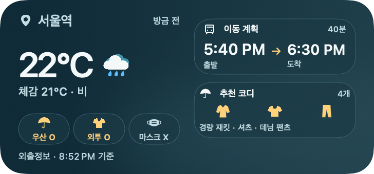
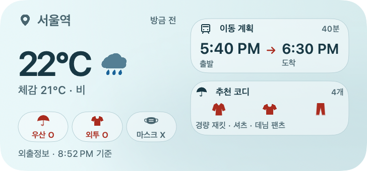
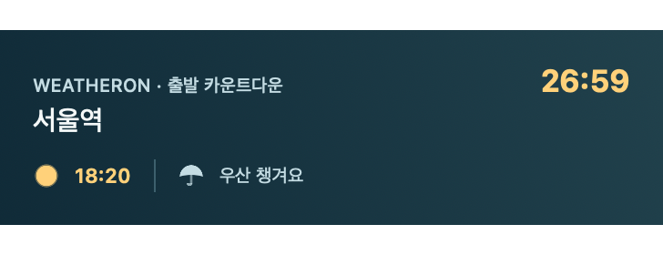
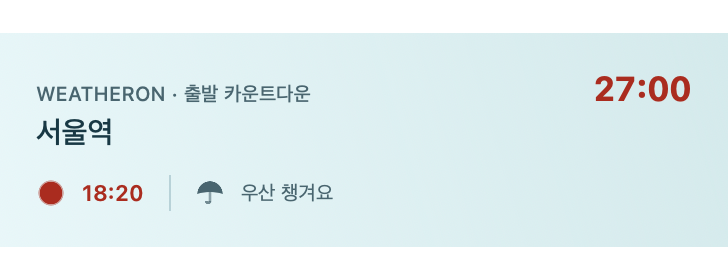
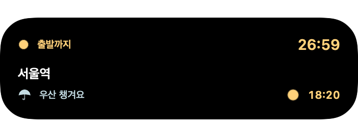
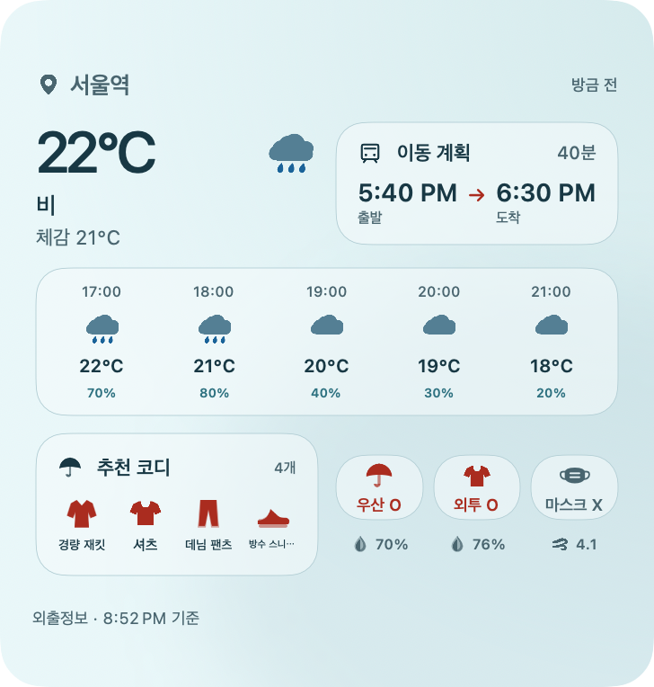

# 위젯 동기화 복구·Ambient Surface 적용

## 변경

- 위젯·Live Activity에 `brandPalette.ts` 기준 청록 배경, 텍스트·강조색, 얕은 표면과 카드 모서리 적용함. 날씨 장식용 대형 SF Symbol 배경 제거함.
- `ambientAssets.ts` / `filledV3Assets.ts`에서 사용하는 원본 PNG를 확장 Asset Catalog에 연결함. 날씨 12종은 라이트·다크 원본 색상 유지하고, UI 14종은 앱과 같은 알파 자산에 의미별 색상 적용함. 앱에 대응 자산이 없는 마스크·새로고침·방향 화살표는 기존 시스템 기호 유지함.
- 잠금 화면, Dynamic Island 확장·축소·최소 화면이 같은 아이콘 렌더러 사용함. Live Activity 시작·업데이트·종료·딥링크 로직은 변경하지 않음.
- 위젯 독립 WeatherKit 조회의 진눈깨비·우박·혼합 강수·먼지 분류를 앱과 맞추고 한국어·영어·일본어 문구 추가함. 강한 비는 번개 아이콘으로 대체하지 않음.
- 대형 위젯 날씨 상태·체감온도 공간 확보, 12시간제 시각 잘림과 소형 위젯 출발 라벨 번역 누락 보정함.
- App Group 접근·파일 저장 실패 진단 로그 추가함. 위치·스냅샷 원문은 로그에 남기지 않음.
- 유선 Debug가 내장 JS를 사용하는데 Expo devtools가 Metro 연결을 요구하는 실행 오류 수정함. 실기기 Debug만 production-mode JS를 내장하고 시뮬레이터 Debug와 Release 동작은 유지함.

## 기기 확인

- 설치 전 Build 53에서 공유 컨테이너 조회 실패하고, 사용자 화면은 `앱에서 업데이트` 및 목적지 목록 누락 상태였음.
- 앱·위젯을 기존 App Group 권한으로 개발 서명하고 같은 앱 ID로 갱신 설치한 뒤 공유 날씨·위치 파일 생성 확인함. 저장 목적지 3개의 ID가 두 파일에서 동일한 것 확인함.
- 실제 iPhone의 기존 중형 위젯에서 현재 위치·16°C·체감 17°C·시간별 예보·코디와 갱신 시각이 표시되는 것 직접 확인함. 최종 앱 원본 날씨·우산·옷차림·위치 아이콘 표시도 직접 확인함. 위젯 삭제·재추가는 하지 않았음.
- CoreDevice 앱 목록의 App Group 빈 칸은 새 설치에서도 같았음. 이를 서명 누락의 증거로 사용하지 않음. 이전 설치본의 정확한 내부 실패 원인은 확정하지 못했음. 공유 데이터 복구는 재설치 후 파일 접근과 실제 위젯 표시로 확인한 것임.
- 2026-10-21 사용자가 위치 선택 UI와 Live Activity 실기기 확인 완료를 직접 보고함. 해당 항목은 사용자 확인 완료로 기록함. 개별 시작·완료·딥링크 등 세부 시나리오별 통과를 별도로 추정하지 않음.

## 검증

| 검사 | 결과 |
| --- | --- |
| `bash scripts/check-widget-native-weather.sh` | 실제 Swift 코디네이터 mock 검사, 날씨 분류 9종, 전체 위젯·Live Activity iOS SDK 타입 검사 통과함 |
| `node scripts/check-ios-widget-icons.mjs` | 앱 원본 PNG 바이트 일치, 날씨/밤/미확인 상태 매핑, 3개 언어 문구 검사 통과함 |
| `node scripts/check-ios-widget-sync.mjs` | 공유 내보내기·실패 재시도·목적지 카탈로그 회귀 통과함 |
| `node scripts/check-ios-live-activity.mjs` | 기존 ActivityKit 생명주기·여백·연결 계약 검사 통과함 |
| `node scripts/check-ios-device-bundle.mjs` | 실기기/시뮬레이터 × Debug/Release 4가지 모드 검사 통과함 |
| 위젯 날짜·시간 | daylight, 시간 라벨 69건, 갱신 시각 162건 검사 통과함 |
| 로컬 Xcode 27.1 Debug | 전체 빌드, 앱·확장 서명 및 동일 App Group, 같은 앱 ID 설치·실행 통과함 |
| 렌더 | 실제 SwiftUI 뷰를 macOS 어댑터와 합성 데이터로 렌더함. 소·중·대형 및 잠금 화면 라이트·다크, Dynamic Island 확장 화면 확인함. 실제 WidgetKit/ActivityKit 전체 기기 조합의 증거는 아님 |

## 설치본 기준과 한계

작업 폴더의 앱 버전은 41이고 기존 기기 설치본은 53이었음. 기존 출발 목적지 고정 로직을 보존하기 위해 최종 로컬 QA 설치는 현재 작업 폴더의 네이티브 변경에 Build 53 소스 `2ce655e`에서 생성한 production-mode JS 실행 번들을 결합한 개발 서명 빌드임. 이는 단일 커밋에서 만들어진 배포 후보가 아님. 공개 배포 전 같은 네이티브 패치를 배포 브랜치에 반영하고 Xcode Cloud/TestFlight로 검증해야 함.

새 Live Activity 디자인은 합성 렌더·계약 검사 및 사용자 실기기 확인 완료 상태임. 개별 시작·완료 시나리오별 결과와 앱을 장시간 닫은 상태의 자동 날씨 갱신은 별도로 확인하지 않았음. Xcode Cloud·TestFlight·스토어 배포·커밋·푸시는 수행하지 않았음. 기존 앱 데이터는 초기화하지 않았고 앱의 기존 위치·목적지 복원은 확인했으나 전 데이터의 전후 동일성 감사는 수행하지 않았음.

## 원본 아이콘 동기화

```sh
node scripts/sync-ios-widget-icons.mjs
node scripts/check-ios-widget-icons.mjs
```

원본 디자인이 바뀌면 첫 명령으로 Asset Catalog를 다시 생성한 뒤 두 번째 명령으로 원본 일치 여부 확인하면 됨.

## 합성 미리보기







